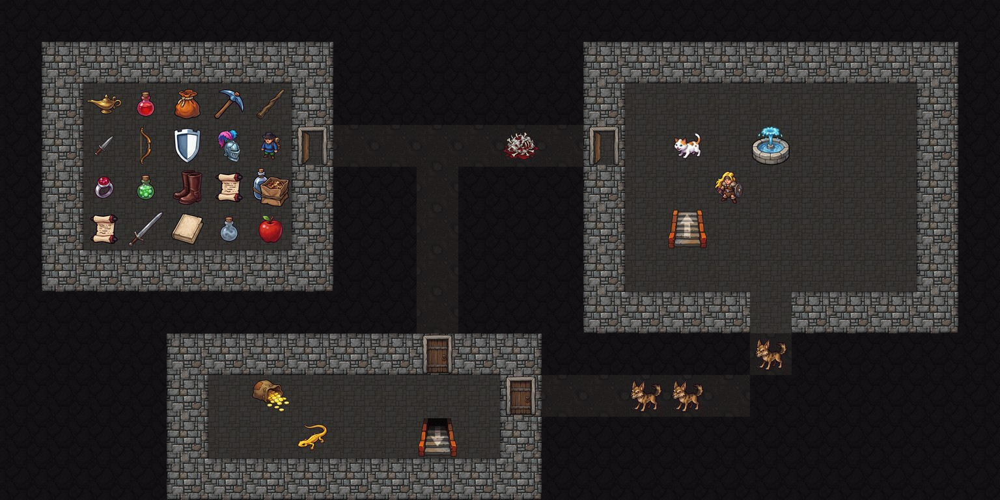

# NetHack for macOS

[](https://github.com/glorat/nethack-cocoa/actions/workflows/ci.yml)
[](https://github.com/glorat/nethack-cocoa/releases/latest)

A native Mac app for [NetHack 5.0](https://www.nethack.org/), the classic roguelike dungeon crawl. It has a native Mac interface, a new painted tile set, and runs on Apple Silicon and Intel Macs.



*The painted tile set, shown on a sample level.*

## Features

### New in this version

- **Full NetHack 5.0.0.** The complete, current game, not a variant.
- **Painted tiles** at 64px and 128px, drawn over the floor beneath them.
- **Zoom** with ⌘= and ⌘−, ⌘0 for actual size, or pinch on a trackpad.
- **Ready-to-run download** for Apple Silicon and Intel Macs.

### From the original NetHack Cocoa

- **Classic 16px tiles**, and you can add your own tile sets.
- **ASCII mode** with a font of your choice, for players who prefer the traditional look.
- **Mac menus for game commands.** Move, Gear, Action and Magic menus list commands with their keys, so you can play without memorising them.
- **Dialogs** for inventory menus, prompts, directions, extended commands and character creation.
- **Status and equipment panels**, and a notes window for your own notes.
- **Speech**, which reads game messages aloud.

## Install

Requires macOS 12 or later.

1. Download the zip from the [latest release](https://github.com/glorat/nethack-cocoa/releases/latest) and open it.
2. Drag **NetHack 5** into your Applications folder.
3. Open NetHack 5. macOS will say it can't check the app for malicious software, because this free, open-source build isn't notarized by Apple. Click **Done**.
4. Open **System Settings → Privacy & Security**, scroll down, and click **Open Anyway** next to the message about NetHack 5.

You only need to do this once.

## Playing

New to NetHack? The [NetHack wiki](https://nethackwiki.com/) has guides for beginners, and the game includes a tutorial.

NetHack options can be set from **Game → Options**, or in a `.nethackrc` file in the app's sandbox, `~/Library/Containers/io.github.glorat.nethack/Data/.nethackrc`. Saved games are in `nethackdir/save` in the same folder.

## Building from source

You need full [Xcode](https://developer.apple.com/xcode/) (not just the Command Line Tools) and [Git LFS](https://git-lfs.com/), which stores the tile sets.

```sh
git lfs install
git clone https://github.com/glorat/nethack-cocoa.git
cd nethack-cocoa
make -C win/cocoa
open win/cocoa/build/NetHack.app
```

The first build also builds the NetHack core and downloads Lua, so it takes a few minutes. Add `ARCHFLAGS="-arch arm64 -arch x86_64"` for a universal app.

The Mac interface is in [`win/cocoa`](../win/cocoa). The rest of the tree is the NetHack core, kept close to upstream so new NetHack releases can be merged in.

## Contributing

Bug reports and pull requests are welcome. Open pull requests against `main`; CI builds every pull request. Please report problems with the game itself, rather than the Mac interface, to [NetHack upstream](https://github.com/NetHack/NetHack).

## Credits

- **NetHack** by the NetHack DevTeam and many contributors over the years.
- **Cocoa interface** by Dirk Zimmermann and Bryce Cogswell, ported to NetHack 5.0 by Kevin Tam.
- **Painted tiles** by Kevin Tam ([glorat](https://github.com/glorat)).

This is an independent project, not an official NetHack DevTeam release.

## License

- The Mac interface in `win/cocoa` is licensed under the [GNU General Public License v2](../win/cocoa/license.txt), except where a file's header says otherwise.
- NetHack and the tile sets are licensed under the [NetHack General Public License](../dat/license).
